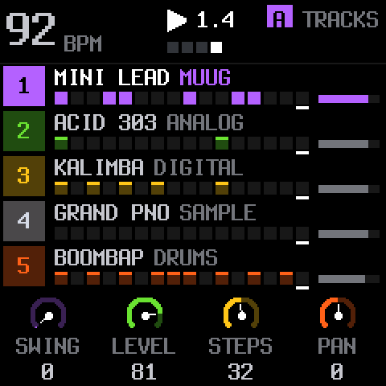
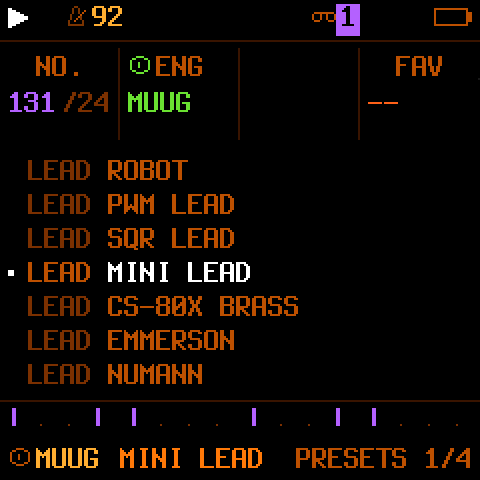
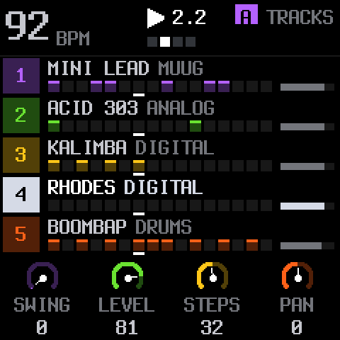
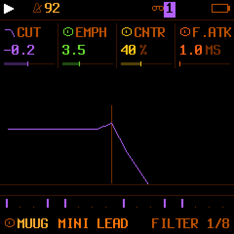
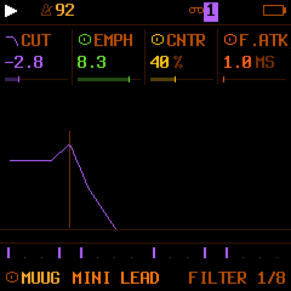
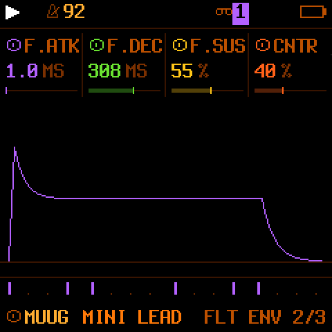

<h1 align="center">Kitten Synths</h1>

<b>Free firmware for the M-VAVE FM-1: a groovebox with a Minimoog-style synth and a fourth light synth part.</b> 
By <b>Black Kitten Devices</b> · GPL-3.0 · based on <a href="https://github.com/isod89/sloop-fm1">SLOOP</a>, <a href="https://github.com/hugelton/Felucca">Felucca</a> and <a href="https://github.com/ruppert/fmini-1">FMini-1</a>

<a href="MANUAL.en.md"><b>Manual</b></a> ·
<a href="https://blackkittendevices.github.io/Kitten-Synths/play/?fw=kittensynths"><b>▶ Play in the browser</b></a> ·
<a href="https://blackkittendevices.github.io/Kitten-Synths/site/webapp/editor/">Web editor</a> ·
<a href="CHANGELOG.md">Changes</a> ·
<a href="LICENSE">License</a> ·
<a href="README.md">Español</a>

---

> ### 🎛️ NEW: record 7 tracks into your DAW
> The FM-1 is an 8-channel USB sound card: the stereo master plus each synth track and the drums on its own channel, no drivers. [How to use it](MANUAL.en.md#usb-audio).

## What is it?

Kitten Synths turns the FM-1 into a groovebox for playing live with **four synths and drums**. It starts from SLOOP 2.8 (twelve synth engines, a 64-step sequencer, song mode, punch-in effects, your own samples, MIDI and USB audio) and adds:

- **MUUG**: an engine in the style of Moog's classic three-oscillator synths, ported from FMini-1, with **100 factory sounds**, a 24 dB/oct ladder filter and all its edit pages on the FM-1 itself (no web editor needed). Up to 8 voices, by preset.
- **A fourth "LITE" synth part** (grey, before the drums), for extra layers without loading the processor: it plays the DIGITAL, PHASE, LOFI, SAMPLE and VOICE engines.
- **Multitrack recording over USB**: 8 channels, the master on 1-2 and each track on its own (the 4 synths and the drums), to record them in your DAW.
- **Its own installer and web editor**, which know the five tracks and read MIDI from a controller.
- A Halloween look: the PUMPKIN palette (orange on black), a boot kitten and a kitten visualizer that blinks on the tempo.

**MIDI compatibility is identical to SLOOP's**: the same channels, the same messages, the same map. **USB audio**: the computer sees the FM-1 as an 8-channel sound card: the master on channels 1-2 (as in SLOOP) and each track on its own channel.

> **Status:** beta. Tested on a real FM-1 by its author (editor, MIDI, CPU, saving). Installing custom firmware is still **at your own risk** and without warranty. Read [Before installing](#before-installing).

## Screenshots

FM-1 screens made with the firmware's real code (the device shows the same, at 240 × 240 pixels).

| | | |
| --- | --- | --- |
|  **Tracks**: three synths, LITE and drums |  **Sound list** (MUUG) |  **LITE part** selected |
|  **MUUG**: filter curve |  The same curve with **resonance** |  **MUUG**: filter contour |

## Install (short version)

1. From *Releases*, download `Kitten-Synths-instalador-….zip` and unzip it.
2. Run `servir.py` (needs Python 3 and Chrome or Edge). The installer opens.
3. Plug in the FM-1 with a USB **data** cable, straight into the computer (no hub), and press **Install**.
4. Wait for the done message. The FM-1 restarts with the kitten logo. Unplug and plug it in once so the computer finds the USB audio.

Step by step in the [Manual, chapter 2](MANUAL.en.md#2-installing).

### Before installing

- **Back up** what you have on the FM-1 (songs, your presets, samples) with the web editor of the firmware you use now.
- Keep a rescue tool at hand, such as [FM-1-transporter](https://github.com/kurogedelic/FM-1-transporter), in case a device stops starting.
- The official M-VAVE V15 firmware is hard to find now, and the Kitten Synths installer does **not** offer "back to V15". To go back you can install the `.fwsc` of another compatible firmware, for example SLOOP.
- If something goes wrong: hold **OCT−** at power-on (USB rescue) and install again.

## The Firmware Hub

Kitten Synths meets the requirements of [The FM-1 Firmware Hub](https://thefirmwarehub.com/kb/): it is free (GPL-3.0), it makes music, each Release's `.fwsc` carries Felucca's update loader, and it reports **`FM-1_969`** (its own identity, not shared). The card's text, its ▶ play key and its editor key come from `fmhub.json`; the browser simulator and the editor are published on GitHub Pages by the build.

## What is in this repository

| File | What it is for |
| --- | --- |
| `muug.patch` and `fix-01.patch` … `fix-17.patch` | Everything Kitten Synths adds to SLOOP 2.8, in order, applied to a pinned SLOOP commit. |
| `.github/workflows/build.yml` | Fetches SLOOP, applies the patches, runs the tests, builds with JieLi's toolchain and publishes the site. |
| `servir.py` | Serves the installer and the simulator on your computer. |
| `splashes y logos/` | The kitten pictures (welcome, eyes open and closed). |
| `capturas/` | The screenshots. |
| `MANUAL.en.md` / `MANUAL.md` | The manual, in English / Spanish. |
| `CARACTERISTICAS.md` | Spec sheet and sound list (Spanish). |
| `COMPILAR.md` | How the build works and how to run it by hand (Spanish). |
| `CHANGELOG.md` | History of changes. |
| `CREDITOS.md`, `LICENCIA.md`, `LICENSE` | Credits and license (GPL-3.0). |

The repository keeps no copy of SLOOP: each build fetches it from its author and applies the patches, so their work is respected and what Kitten Synths changed is plain to see.

## Credits and thanks

Kitten Synths exists thanks to others' work: **Leo Kuroshita / Hügelton Instruments** (Felucca), **isod89** and contributors (SLOOP) and **Guilherme Ruppert** (FMini-1, where the MUUG engine comes from). Details in [CREDITOS.md](CREDITOS.md).

## License

Code under **GPL-3.0**, like SLOOP, Felucca and FMini-1. If you distribute the firmware or a modified version, you must also provide its source code under the same license.

---

Black Kitten Devices · =^.^=

