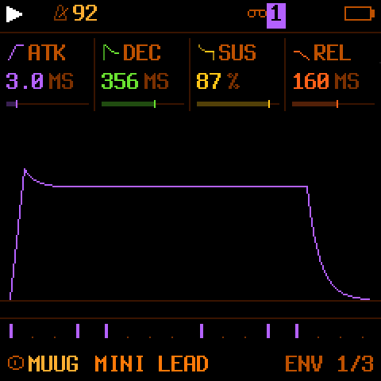
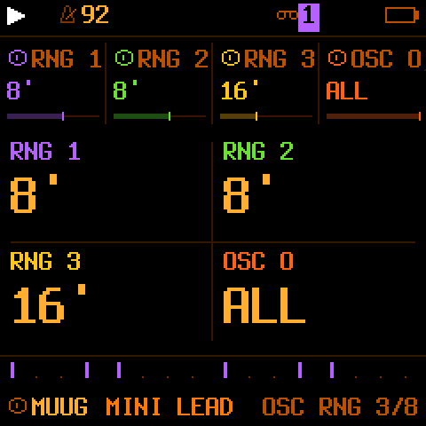
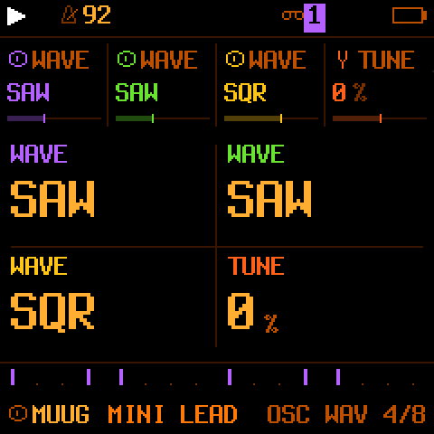
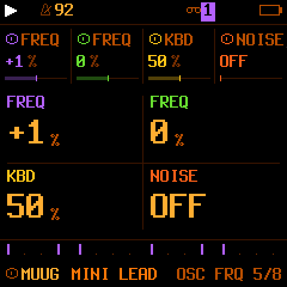
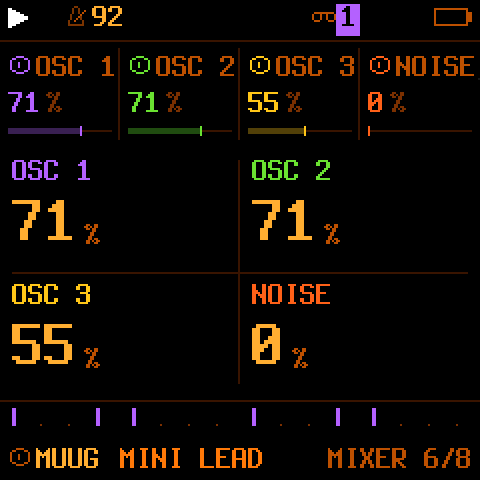
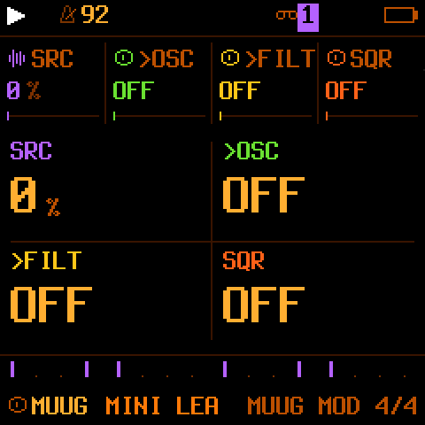
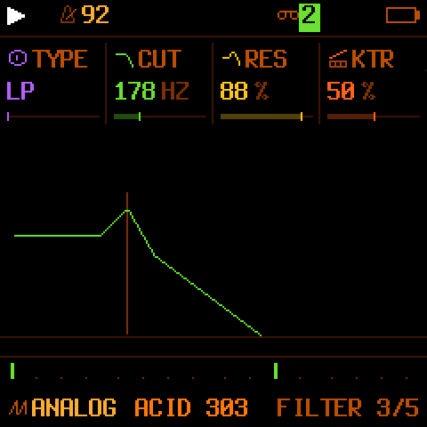
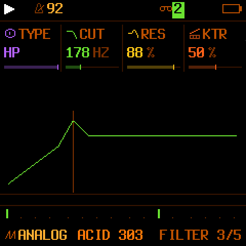
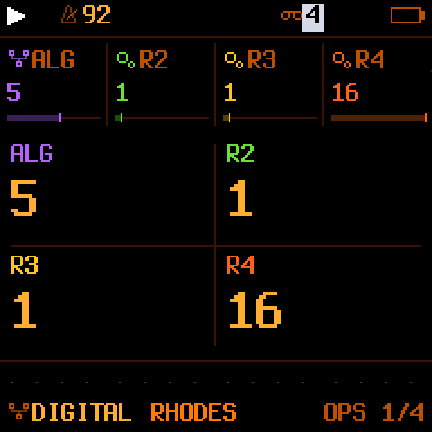
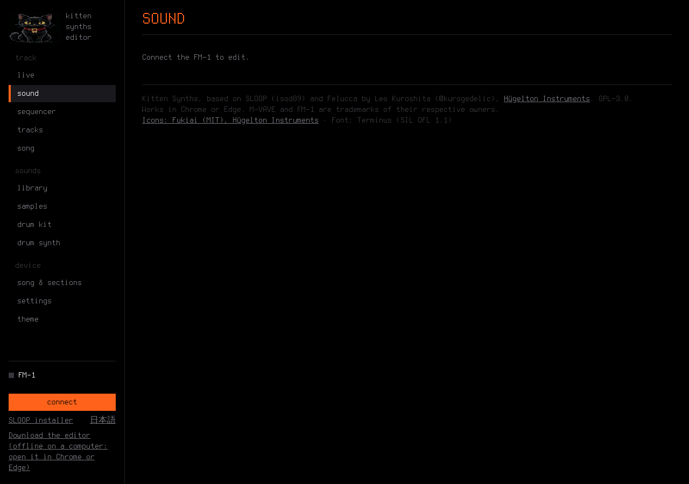

<h1 align="center">Kitten Synths</h1>

<b>Firmware libre para el M-VAVE FM-1: una groovebox con un sintetizador tipo Minimoog, un cuarto sintetizador liviano.</b> 
Por <b>Black Kitten Devices</b> · GPL-3.0 · basado en <a href="https://github.com/isod89/sloop-fm1">SLOOP</a>, <a href="https://github.com/hugelton/Felucca">Felucca</a> y <a href="https://github.com/ruppert/fmini-1">FMini-1</a>

<a href="MANUAL.md"><b>Manual</b></a> ·
<a href="CARACTERISTICAS.md">Características</a> ·
<a href="COMPILAR.md">Compilar</a> ·
<a href="CHANGELOG.md">Cambios</a> ·
<a href="CREDITOS.md">Créditos</a> ·
<a href="LICENCIA.md">Licencia</a> ·
<a href="https://blackkittendevices.github.io/Kitten-Synths/simulator/index.html?mock=1"><b>▶ Probar en el navegador</b></a> ·
<a href="https://blackkittendevices.github.io/Kitten-Synths/site/webapp/editor/">Editor web</a> ·
<a href="README.en.md">English</a>

---

> ### 🎛️ NUEVO: grabá 7 pistas en tu DAW
> El FM-1 es una placa de sonido USB de 8 canales: el master estéreo y cada sinte y la batería en su propio canal, sin drivers. [Cómo se usa](MANUAL.md#audio-usb).

## ¿Qué es?

Kitten Synths convierte el FM-1 en una groovebox para tocar en vivo con **cuatro sintetizadores y una batería**. Parte de SLOOP 2.8 (doce motores de síntesis, secuenciador de 64 pasos, modo canción, efectos de golpe, muestras propias, MIDI y audio USB) y le suma:

- **MUUG**: un motor al estilo de los clásicos de tres osciladores de Moog, portado desde FMini-1, con **100 sonidos de fábrica**, filtro de escalera de 24 dB/oct y todas sus pantallas de edición en el propio FM-1 (no hace falta el editor web). Hasta 8 voces según el preset.
- **Una cuarta parte sintetizadora "LITE"** (gris, antes de la batería), pensada para sumar capas sin cargar el procesador: toca los motores DIGITAL, PHASE, LOFI, SAMPLE y VOICE.
- **Grabación multipista por USB**: 8 canales, el master en 1-2 y cada pista por separado (los 4 sintes y la batería), para grabarlas en el DAW.
- **Instalador y editor web** que reconocen las cinco pistas y leen MIDI desde un controlador.

La **compatibilidad MIDI es idéntica a la de SLOOP**: mismos canales, mismos mensajes, mismo mapa. Lo que ya funcionaba con SLOOP funciona igual.

> **Estado:** beta. Probado en un FM-1 real por su autor (editor, MIDI, CPU, guardado). Aun así, instalar firmware propio es **bajo tu propio riesgo** y sin garantía. Leé [Antes de instalar](#antes-de-instalar).

## Capturas

Pantallas del FM-1 generadas con el código real del firmware (en el equipo se ven igual, a 240 × 240 píxeles).

| | | |
| --- | --- | --- |
|  **Pistas**: tres sintes, LITE y batería |  **Lista de sonidos** (MUUG) |  **Parte LITE** seleccionada |
|  **MUUG**: curva del filtro |  La misma curva con **resonancia** |  **MUUG**: contorno del filtro |
|  Envolvente principal |  MUUG: rangos de osciladores |  MUUG: formas de onda |
|  MUUG: frecuencias |  MUUG: mezclador |  MUUG: modulación |
|  ANALOG: filtro pasabajos |  ANALOG: filtro pasaaltos |  Edición de la parte LITE |

El editor web (se abre desde el instalador).

## Instalar (resumen)

1. Entrá a la pestaña **Actions** de este repositorio → **build** → **Run workflow** (o bajá una versión ya compilada si hay una en *Releases*).
2. Cuando termine, descargá el artefacto **kitten-synths** y descomprimilo.
3. Ejecutá `servir.py` (necesita Python 3 y Chrome o Edge). Se abre el instalador.
4. Conectá el FM-1 con un cable USB **de datos**, directo a la computadora (sin hub), y apretá **Instalar**.
5. Esperá el aviso de listo. El FM-1 se reinicia con el logo del gatito. Desenchufalo y enchufalo una vez para que la computadora reconozca el audio USB.

Paso a paso en el [Manual, capítulo 2](MANUAL.md#2-instalación).

### Antes de instalar

- Hacé una **copia de seguridad** de lo que tengas en el FM-1 (canciones, presets propios, muestras) con el editor web del firmware que uses ahora.
- Tené a mano una herramienta de rescate, como [FM-1-transporter](https://github.com/kurogedelic/FM-1-transporter), por si un equipo deja de arrancar.
- El firmware oficial V15 de M-VAVE ya no se consigue fácilmente, y el instalador de Kitten Synths **no** trae una opción de "volver a V15". Para volver atrás podés instalar el `.fwsc` de otro firmware compatible, por ejemplo SLOOP.
- Si algo sale mal: mantené **OCT−** apretado al encender (rescate USB) y volvé a instalar.

## Firmware Hub

Kitten Synths cumple los requisitos de [The FM-1 Firmware Hub](https://thefirmwarehub.com/kb/): es libre (GPL-3.0), hace música, trae el cargador de actualización de Felucca en el `.fwsc` de cada Release y se identifica como **`FM-1_969`** (identidad propia, no compartida). La tarjeta usa el texto (en inglés, como pide el Hub), el botón ▶ y el del editor de `fmhub.json`; el simulador y el editor se publican en GitHub Pages en cada compilación.

## Probar sin FM-1

Online, sin instalar nada: [el simulador](https://blackkittendevices.github.io/Kitten-Synths/simulator/index.html?mock=1) y [el editor web](https://blackkittendevices.github.io/Kitten-Synths/site/webapp/editor/). El paquete también trae el simulador, en `http://localhost:8766/simulator/index.html?mock=1` (con `servir.py` en marcha). Sirve para escuchar los sonidos y probar el editor, pero no reemplaza al hardware.

## Qué hay en este repositorio

| Archivo | Para qué sirve |
| --- | --- |
| `muug.patch` y `fix-01.patch` … `fix-17.patch` | Todo lo que Kitten Synths agrega a SLOOP 2.8, en orden. Se aplican sobre un commit fijo de SLOOP. |
| `.github/workflows/build.yml` | Baja SLOOP, aplica los parches, corre los tests y compila con la cadena de herramientas de JieLi. |
| `servir.py` | Sirve el instalador y el simulador en tu computadora. |
| `splashes y logos/` | Las imágenes del gatito (bienvenida, ojos abiertos y cerrados). |
| `capturas/` | Las capturas de pantalla de este README. |
| `MANUAL.md` / `MANUAL.en.md` | Manual de uso, en español / en inglés. |
| `README.en.md` | Este README en inglés. |
| `CARACTERISTICAS.md` | Ficha técnica y lista de sonidos. |
| `COMPILAR.md` | Cómo funciona la compilación y cómo hacerla a mano. |
| `CHANGELOG.md` | Historia de cambios. |
| `CREDITOS.md`, `LICENCIA.md`, `LICENSE` | Créditos y licencia (GPL-3.0). |

El repositorio no guarda una copia de SLOOP: la descarga de su autor en cada compilación y le aplica los parches. Así se respeta su trabajo y se ve con claridad qué cambió Kitten Synths.

## Créditos y gracias

Kitten Synths existe por el trabajo de otros: **Leo Kuroshita / Hügelton Instruments** (Felucca), **isod89** y colaboradores (SLOOP) y **Guilherme Ruppert** (FMini-1, de donde sale el motor MUUG). Detalle en [CREDITOS.md](CREDITOS.md).

## Licencia

Código bajo **GPL-3.0**, igual que SLOOP, Felucca y FMini-1. Si distribuís el firmware o una versión modificada, tenés que entregar también su código fuente bajo la misma licencia. Más en [LICENCIA.md](LICENCIA.md).

---

Black Kitten Devices · =^.^=

